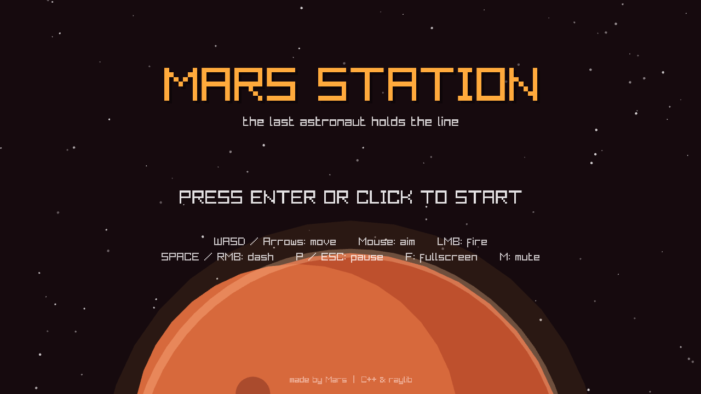
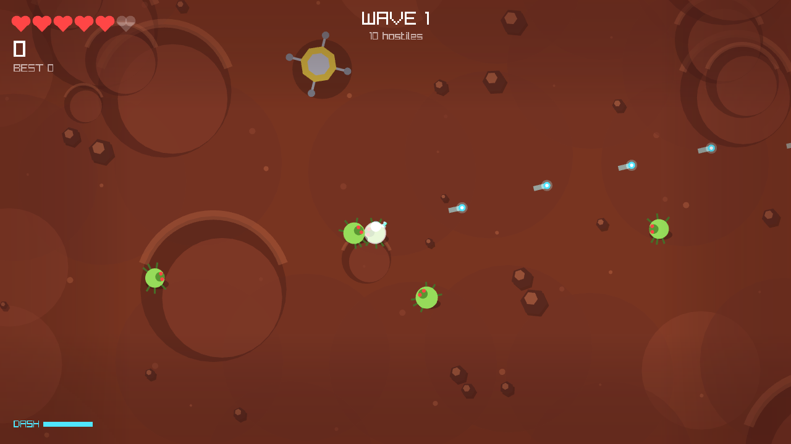
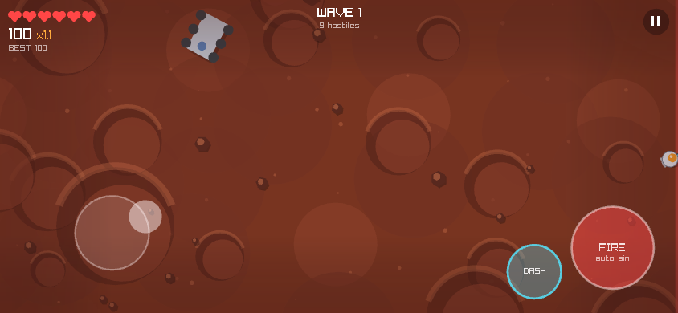

# 🔴 Mars Station

A top-down survival shooter written in **C++17** with **[raylib 5.5](https://www.raylib.com/)**.
You are the last astronaut at an abandoned Mars outpost. Hold the line against waves of Martian
creatures, grab power-ups, and take down the **Sentinel** boss every 5th wave.

▶️ **Play in your browser (PC, Android, iPhone):** https://leffstroi.github.io/mars-station/
💾 **Download for Windows:** [MarsStation.exe](https://github.com/leffstroi/mars-station/releases/latest/download/MarsStation.exe) — [all releases](https://github.com/leffstroi/mars-station/releases)

| Title | Gameplay | iPhone (touch) |
|---|---|---|
|  |  |  |

## Controls

| Action | Keyboard + mouse | Gamepad | Touch (phone / tablet) |
|---|---|---|---|
| Move | `WASD` / arrow keys | left stick | virtual joystick — put your thumb anywhere on the **left** half |
| Aim | mouse | right stick | automatic (aims at the nearest enemy) |
| Fire | hold left mouse button (or `J`/`K` for auto-aim) | right stick / `A` / `RT` | hold the **FIRE** button (anywhere on the right half works) |
| Dash (dodge, brief invulnerability) | `Space` / `Shift` / right mouse | `B` / `LT` | **DASH** button |
| Pause | `P` / `Esc` | Start | ⏸ button, top-right |
| Fullscreen / Mute | `F` / `M` | — | — |

## How to play

- Survive endless **waves**. Each wave sends more enemies; clearing one gives bonus points and repairs 1 hull.
- **Combo:** kill quickly to raise the score multiplier (up to ×8). Getting hit resets it.
- **Enemies**
  - 🟢 **Crawler** — chases you.
  - 🟡 **Swarmer** — small, fast, zig-zags.
  - 🟣 **Spitter** — keeps its distance and shoots acid.
  - 🟠 **Brute** — armored; flashes, then **charges** in a straight line (watch the red line and dash aside).
  - ⚙️ **Sentinel** (boss, every 5th wave) — radial bursts, aimed sprays, and summons swarmers.
- **Power-ups** (dropped by enemies): `+` hull repair, `S` spread shot, `R` rapid fire, `O` shield (absorbs one hit).
- Your **best score** is saved (in the browser's local storage on the web, in `marsstation_best.dat` on Windows).

> iPhone tip: turn the silent switch off to hear sound, and use landscape for the best view.
> "Share → Add to Home Screen" makes it open full-screen like an app.

## Features

- Pure C++ / raylib, no external assets: all graphics are drawn in code and **all sound effects + the music loop are synthesized at startup**.
- Procedural Mars terrain with craters, rocks and abandoned equipment (landers, rovers, solar arrays).
- Particles, screen shake, hit flashes, floating score text, boss health bar.
- Resolution-independent: works on any window size, phone portrait or landscape.
- Multi-touch controls (floating joystick + fire + dash) for mobile browsers.

## Building from source

Requirements: `git`, `make`, a C++17 compiler, plus
[emsdk](https://emscripten.org/docs/getting_started/downloads.html) for the web build and
`mingw-w64` (`x86_64-w64-mingw32-g++`) for the Windows build.

```bash
./scripts/setup_raylib.sh      # downloads raylib 5.5 and builds static libs into libs/
source /path/to/emsdk/emsdk_env.sh
make web                        # -> build/web/index.html, index.js, index.wasm
make windows                    # -> build/windows/MarsStation.exe (single static .exe)
make linux                      # -> build/linux/mars-station (needs X11 dev headers)
```

Test the web build locally with `python3 -m http.server -d build/web 8000` and open http://localhost:8000.
The web build uses a custom HTML shell (`web/shell.html`) that tracks multi-touch for the on-screen controls.

## Project layout

```
src/main.cpp            game code (single file)
web/shell.html          HTML page for the WebAssembly build (touch handling, loader)
assets/icon.*           Windows icon
scripts/setup_raylib.sh fetch + build raylib
Makefile                web / windows / linux targets
```

Windows may show a SmartScreen warning for an unsigned .exe — click **More info → Run anyway**.

Made by **Mars** · C++ & raylib · MIT License
